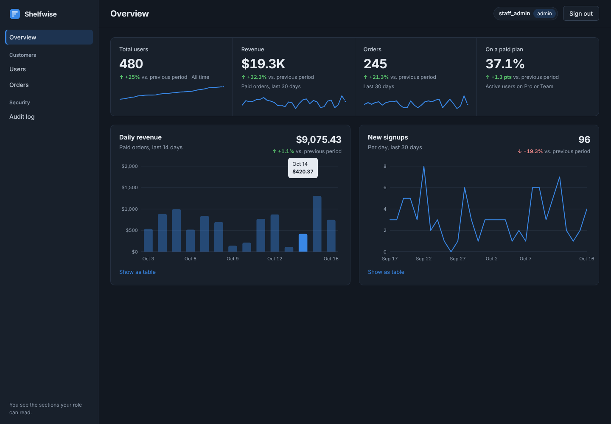
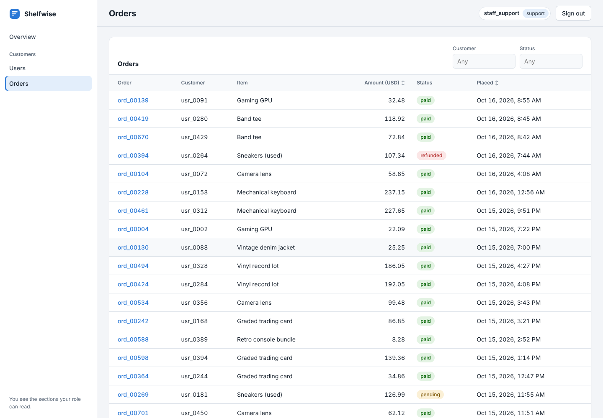

# OpenAdmin Kit

> **Build your product. We provide the admin foundation.**

A small, self-hosted admin toolkit for TypeScript/Express apps. You plug in **your** session check, **your** permission rules, and **your** data. OpenAdmin Kit gives you authenticated, deny-by-default, audited admin API routes, plus an optional React dashboard that shows each role only what it can read.

> ⚠️ **Pre-alpha (0.0.x).** This is a working foundation, not a production-ready package. It has not had an independent security review, the APIs will change, and nothing is published to npm yet.



## Packages

| Package | What it does | Depends on |
|---|---|---|
| `@openadminkit/core` | Registry, deny-by-default authorization, bounded queries, field allowlisting, metrics, audit events | Nothing at runtime |
| `@openadminkit/express` | Mounts the admin API in your Express app | core, Express (peer) |
| `@openadminkit/react` | Optional dashboard: navigation, metric tiles and charts, tables, record drawer | core types, React (peer) |

The core never imports Express or React, and the dashboard is just another API client. Its permissions come from the server.

## Try the demo (about 2 minutes)

You need **Node 22.13+** (for built-in SQLite) and **pnpm 9+**.

```bash
pnpm install
pnpm build
pnpm demo
```

Open http://localhost:3000 and sign in as one of the three demo staff accounts:

| Account | Sees |
|---|---|
| **Avery, admin** | Everything, including revenue and the audit log |
| **Sky, support** | Customers and orders, but no revenue numbers and no audit log |
| **Ari, analyst** | Metrics only, including revenue, and no customer records |

The demo (`examples/express-sqlite`) is a fictional reseller-inventory SaaS called *Shelfwise*, with 480 customers and their orders in SQLite. It shows parameterized SQL, keyset pagination, a persisted audit log, and SQL-computed metrics. Set `DB_FILE=./shelfwise.db` to keep data between restarts.

There's also a minimal API-only example with in-memory data: `pnpm example`.



## Adding it to your own Express app

```ts
import { createRolePolicy, defineAdminModule, defineMetric, defineResource } from '@openadminkit/core';
import { createExpressAdmin } from '@openadminkit/express';

const users = defineResource({
  id: 'users',
  label: 'Users',
  permissionPrefix: 'users',            // checks "users.read"
  idField: 'id',
  fields: {                              // ONLY these fields ever leave the server
    id: { type: 'string' },
    email: { type: 'string', filterable: true },
    createdAt: { type: 'date', sortable: true },
  },
  list: (ctx, query) => myUserService.listForAdmin(ctx.actor, query),  // query is validated + bounded; AND your tenant scope separately
  get: (ctx, id) => myUserService.findForAdmin(ctx.actor, id),         // return null if missing OR out of scope
});

const activeUsers = defineMetric({
  id: 'active-users',
  label: 'Active users',
  permission: 'metrics.read',
  load: async () => ({ value: await myStats.activeUsers(), previous: await myStats.activeUsersLastMonth() }),
});

app.use('/internal/admin/api', createExpressAdmin({
  authenticate: (req) => {               // your existing session/JWT check
    const s = req.session?.user;
    return s ? { id: s.id, roles: s.roles } : null;
  },
  authorize: createRolePolicy({ admin: ['users.read', 'metrics.read'] }),   // or your own (input) => boolean
  audit: (event) => myAuditTable.insert(event),                            // storage you own
  modules: [
    defineAdminModule({ id: 'users', label: 'Users', permissions: ['users.read'], resources: [users] }),
    defineAdminModule({ id: 'stats', label: 'Stats', permissions: ['metrics.read'], resources: [], metrics: [activeUsers] }),
  ],
}));
```

Then, optionally, add the dashboard to a page your app already protects:

```tsx
import { AdminApp } from '@openadminkit/react';
import '@openadminkit/react/styles.css';

<AdminApp apiBase="/internal/admin/api" appName="My app" loginUrl="/login" />
```

- [docs/getting-started.md](docs/getting-started.md) walks through the backend step by step.
- [docs/dashboard.md](docs/dashboard.md) covers the React package: theming, content security policy, and what each screen does.

## API surface

| Route | Purpose |
|---|---|
| `GET /` | Modules, resources, and metrics this actor can read (drives navigation) |
| `GET /resources/:id?limit=&cursor=&sort=&filter[field]=` | Bounded list, 1–100 rows per page (default 25) |
| `GET /resources/:id/:recordId` | Single record |
| `GET /metrics/:id` | Pre-computed aggregate: `{ value, previous?, series? }` |

Every other method returns `405`. Write actions are planned (RFC-002), but they aren't built.

## Security model

- **The backend is the trust boundary.** The dashboard hides what a role can't read, but that's only a convenience. Every request re-runs `authenticate` and `authorize`.
- **Deny by default.** Only a literal `true` from your `authorize` function grants access. Throws, rejections, timeouts, and `"yes"` all deny.
- **Allowlisted, typed output.** Records are projected onto the declared `fields`, so a `passwordHash` your query happens to return is dropped. Values must match their declared type, or they're sent as `null`. Metric results are strictly validated.
- **Strict input.** Unknown params, undeclared filters and sorts, repeated params, oversized values, and control characters all get a `400`.
- **Bounded callbacks.** A hanging session store, policy check, or audit sink can't hang the request.
- **Frozen config.** Definitions are snapshotted at startup.
- **Audit fail-closed.** If a success event can't be written, the data isn't returned (`503`).
- **No raw errors.** Database errors become a generic `500`. Your `onInternalError` hook gets the real error.
- **Dashboard:** text is rendered as text with no `innerHTML`, it works under a strict CSP with no inline scripts or styles, and requests use `credentials: 'same-origin'`.

Read [docs/security.md](docs/security.md) for the threat-model status and known gaps.

## Development

```bash
pnpm check       # build + typecheck + lint + all tests
pnpm test:pack   # pack all 3 packages, install them into an app outside the repo, typecheck, run, and render
```

## Repository layout

```
packages/core        contracts, registry, engine (no Express/React dependency)
packages/express     Express router
packages/react       optional dashboard
examples/express-sqlite   full demo: SQLite + dashboard
examples/express-basic    minimal API-only demo
docs/                RFC-001, getting started, dashboard, security
scripts/pack-test.mjs
```

## License

[MIT](LICENSE)
